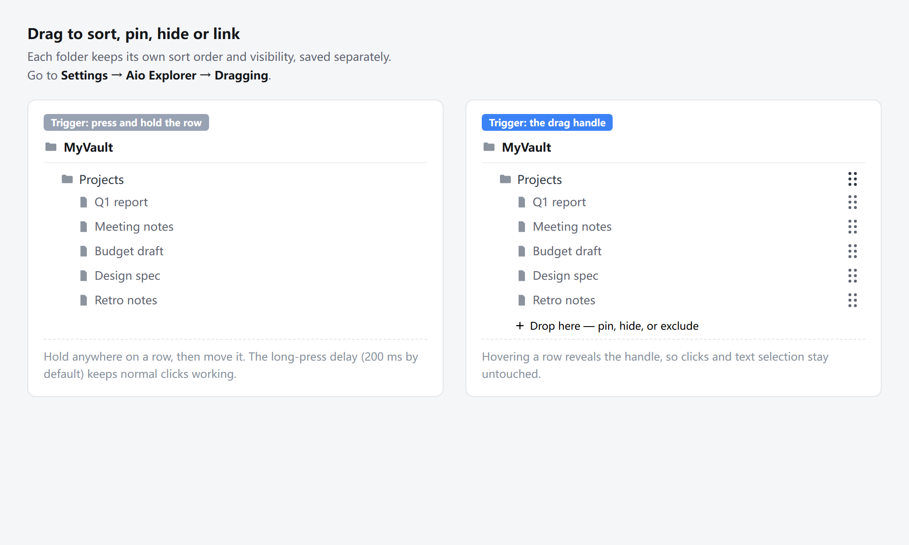
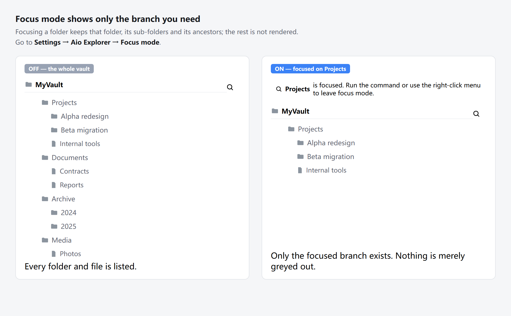
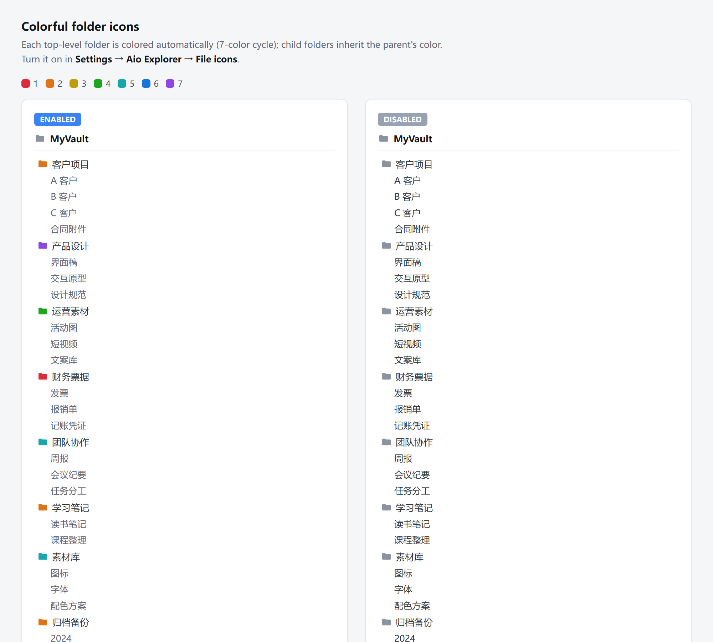
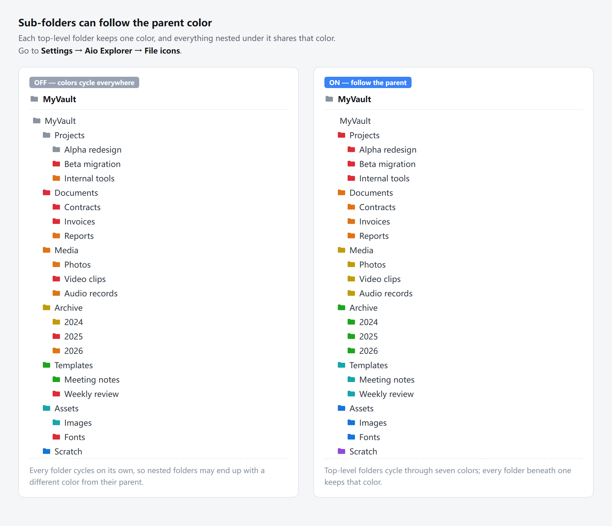
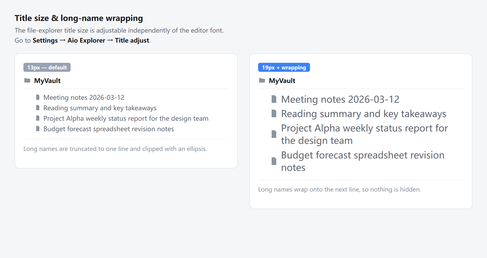

# Aio Explorer

All-in-one file explorer enhancement for Obsidian — per-folder sorting and
drag-and-drop, focus mode, file counts, blank cleanup, and file pinning.

Aio Explorer brings together several file-tree improvements into one settings
page, so you do not have to install and configure a separate plugin for each
one. Every module has its own master switch and can be limited to specific
devices.

**中文说明见下方 [中文说明](#中文说明)。**

---

## What's new in 1.0.1

- **The language switch now covers every surface.** Settings page, right-click
  menus, the live-status panel, the file pin view, ribbon tooltips and the
  command palette all follow the language you pick (Follow Obsidian / 中文 /
  English). Earlier the live-status panel and the file pin view could stay in
  Chinese after switching to English.
- Error notices are no longer hard-coded to Chinese.

---

## Features

### Drag and drop

- **Two trigger modes.** Press and hold anywhere on a row, or hover the row to
  reveal a dedicated drag handle. The handle mode leaves ordinary clicks and
  text selection completely untouched.
- **Per-folder order.** Each folder keeps its own sort order and visibility
  state, saved separately.
- **Long-press delay.** The delay (200 ms by default) keeps normal single
  clicks working, so a drag never turns into an accidental open.
- **Drop targets.** A folder can be pinned, hidden, or excluded from the file
  tree.

### Focus mode

- **One click to narrow the tree.** Focusing a folder keeps that folder, its
  sub-folders, and its ancestors. Everything else is not rendered at all —
  nothing is merely greyed out.
- **Several entry points.** A button at the top of the file explorer, the
  command palette, and the right-click menu.
- **Per-device control.** Focus mode can be enabled separately on desktop,
  tablet, and mobile.

### File icons

- **Colorful folder icons.** Folders cycle through a seven-color palette so you
  can spot structure at a glance.
- **Sub-folders can follow the parent color.** Instead of cycling on their own,
  nested folders inherit the color of the top-level folder they live in. Each
  top-level folder cycles through the same seven-color palette, and everything
  nested under it keeps that color — so the palette never reshuffles while you
  scroll.

### Title adjust

- **Independent title size.** The file-explorer title size is adjustable on its
  own, separate from the editor font size.
- **Separate desktop and mobile sizes.** The desktop and mobile values live in
  the same settings file, so one sync covers every device — phones pick up
  their own size automatically, with no per-device setup.
- **Long names wrap instead of disappearing.** Names that do not fit can wrap
  onto the next line, so nothing is silently truncated.

### File count

- Shows the number of elements under each folder in the file explorer, with an
  option to include expanded folders.

### File cleaner

- Finds empty Markdown files, unreferenced attachments, and empty folders.
- Supports include/exclude extension patterns and a file-age threshold, so
  only genuinely stale files are ever targeted.
- You get a summary of everything found before anything is deleted.

### File pin

- Pin notes and folders to the top of their folder, with per-folder pin groups
  and easy reordering.

---

## Installation

### From the community directory

1. Open **Settings → Community plugins**.
2. Turn off **Restricted mode** if it is on.
3. Click **Browse** and search for **Aio Explorer**.
4. Select **Install**, then **Enable**.

### Manual installation

1. Download `main.js`, `manifest.json`, and `styles.css` from the
   [latest release](https://github.com/Juhao147/aio-explorer/releases).
2. Create the folder `<your vault>/.obsidian/plugins/aio-explorer/`.
3. Copy the three files into that folder.
4. Enable the plugin in **Settings → Community plugins**.

To update, disable the plugin, replace the three files, **keep `data.json`**,
then enable it again. Your settings live in `data.json` and survive updates.

---

## Commands

All commands are available in the command palette (`Ctrl/Cmd + P`).

| Command | What it does |
|---|---|
| Toggle focus mode | Enters or leaves focus mode |
| Clean files | Opens the file-cleaner summary |
| Reload order | Re-reads the saved sort order |
| Reset order — root | Resets the root folder order |
| Show hidden / Hide hidden | Toggles hidden items |
| Save as custom — root | Saves the current root order as a custom preset |
| Open pinned view | Opens the pinned "file area" view |
| Reveal active file | Locates the current note in the file tree |
| Toggle selection mode | Switches the pinned view into multi-select mode |

---

## Settings

Open **Settings → Aio Explorer**. The page is organised into eight tabs:
General, Dragging, Focus mode, File cleaner, File count, File pin, File icons,
and Title adjust.

Every module has a master switch. The focus mode, file cleaner, and file count
modules can also be limited to specific devices, so you can keep the full
feature set on your desktop and a lighter setup on your phone.

The interface follows the Obsidian language setting, with a manual override in
the General tab.

---

## Privacy

Aio Explorer makes **no network requests** and collects **no telemetry**. It
does not read the clipboard and does not scan your vault beyond the files it
already needs to display counts and folder contents.

All settings are stored in `data.json` inside the plugin folder in your vault.

---

## Credits

Aio Explorer is a derivative work built on top of several open-source Obsidian
plugins and a theme. All of them are MIT licensed, and their copyright notices
are preserved in [THIRD-PARTY-NOTICES.md](THIRD-PARTY-NOTICES.md).

- [File Cleaner Redux](https://github.com/husjon/obsidian-file-cleaner-redux) —
  husjon
- [Obsidian File Explorer Count](https://github.com/ozntel/file-explorer-note-count) —
  ozan.pl
- [Folder Pin View](https://github.com/cimuyang/folder-pin-view) — cimuyang
- [Immersive Folder](https://github.com/iBlinkQ/immersive-folder) — Blink
- [Obsidian Border Theme](https://github.com/Akifyss/obsidian-border) — Akifyss

---

## 中文说明

**Aio Explorer** 是一个 Obsidian 文件树增强插件，把多项常用功能整合到一个设置页里，不用为每个功能单独装插件。每个模块都有独立总开关，也可以按设备分别启用。

### 1.0.1 更新内容

- **语言切换真正覆盖所有界面**：设置页、右键菜单、当前生效状态面板、文件置顶面板、侧栏图标提示、命令面板，全部跟随你在「通用」里选的语言（跟随 Obsidian / 中文 / English）。此前把语言切成英文后，状态面板和文件置顶面板仍会显示中文。
- 部分只在中文出现的报错提示，现在也按语言显示。

### 核心功能

**拖拽交互** —— 支持两种触发方式：整行长按，或悬停后显示专用拖拽手柄（手柄模式下普通点击和文字选完全不受影响）。每个文件夹的排序和显示状态**独立保存**。默认 200ms 长按延迟，避免拖拽被误判成点击。文件可拖到文件夹进行置顶、隐藏或排除。

**专注模式** —— 一键收窄文件树。只保留当前聚焦的文件夹、它的子文件夹和它的上级路径，**其余部分完全不渲染**（不是变灰，是真的不显示）。支持文件树顶部按钮、命令面板、右键菜单三种入口，可按电脑/平板/手机分别开关。

**文件图标** —— 文件夹按七色循环上色，一眼看清结构。子文件夹可以选择**跟随父级颜色**：一级文件夹按七色循环，它下面所有层级的子文件夹都跟着同一个颜色，滚动时颜色不会乱跳。

**标题调整** —— 文件树标题字号可**独立于正文字号**单独调整。长文件名可以换行显示，不会被静默截断。电脑端与手机端字号各自独立，但存在同一份设置文件里一起同步，手机上自动生效，无需分别设置。

**文件计数** —— 在文件树中显示每个文件夹下的元素数量，可选是否包含已展开的文件夹。

**文件清理** —— 找出空 Markdown 文件、未被引用的附件和空文件夹。支持包含/排除扩展名模式和文件年龄阈值，只处理真正该清理的旧文件。删除前会先给出完整清单。

**文件置顶** —— 把笔记和文件夹置顶到所在文件夹的顶部，每个文件夹独立分组，可自由调整顺序。

### 安装方法

**从社区插件市场安装**
1. 打开 **设置 → 第三方插件**
2. 如果开着**安全模式**，先关掉
3. 点**浏览**，搜索 **Aio Explorer**
4. 点**安装**，再点**启用**

**手动安装**
1. 从 [Releases](https://github.com/Juhao147/aio-explorer/releases) 下载 `main.js`、`manifest.json`、`styles.css`
2. 新建文件夹 `<你的笔记库>/.obsidian/plugins/aio-explorer/`
3. 把三个文件放进去
4. 在 **设置 → 第三方插件** 中启用

**更新方法**：先停用插件 → 替换三个文件 → **保留 `data.json`** → 再启用。你的设置都存在 `data.json` 里，更新不会丢。

### 设置页

**设置 → Aio Explorer**，共八个标签页：通用、拖拽交互、专注模式、文件清理、文件计数、文件置顶、文件图标、标题调整。

每个模块都有总开关。专注模式、文件清理、文件计数还可按设备分别启用 —— 电脑上开全套，手机上用精简版。

界面语言跟随 Obsidian 的语言设置，也可以在「通用」里手动指定。

### 隐私

**不发起任何网络请求，不收集任何遥测数据**，不读剪贴板。所有设置保存在笔记库插件目录下的 `data.json` 里。

### 致谢

本插件整合了多个 MIT 开源项目，它们的版权声明都保留在
[THIRD-PARTY-NOTICES.md](THIRD-PARTY-NOTICES.md) 中。

---

## License

MIT — see [LICENSE](LICENSE).
